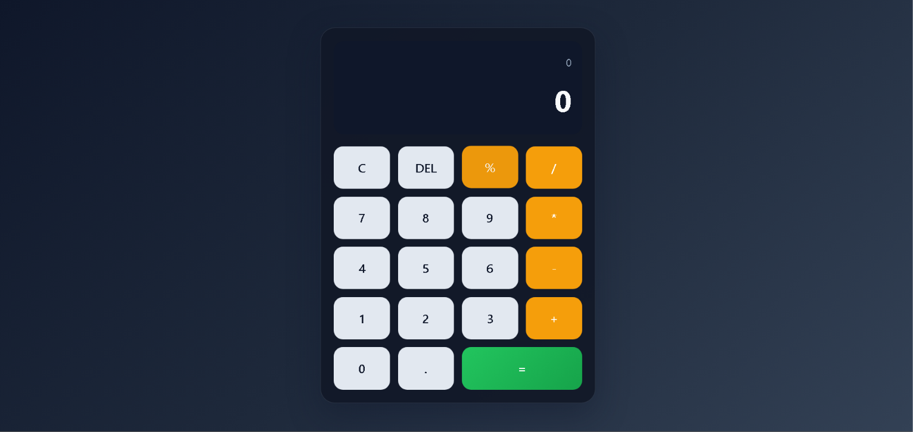

# Ex04 Simple Calculator - React Project
## Date: 14-03-2026
## Name: Prahathieswaran S
## Reg No: 212225240107

## AIM
To develop a simple calculator using React.js with a responsive interface, clean layout, and basic arithmetic functionality for smooth user interaction.

## ALGORITHM
### STEP 1
Initialize a React project using Vite.

### STEP 2
Create the project structure and install required dependencies.

### STEP 3
Create the main calculator component with state for the expression and result.

### STEP 4
Add number buttons, arithmetic operators, clear, delete, and equal functionality.

### STEP 5
Handle input validation and prevent invalid operator sequences.

### STEP 6
Apply styling to make the calculator visually clean and responsive.

### STEP 7
Run the application locally and test basic operations such as addition, subtraction, multiplication, division, and decimal calculations.

### STEP 8
Check the final output and verify the app works correctly.

## PROGRAM
```jsx
import { useMemo, useState } from 'react';
import './App.css';

const buttonLayout = [
  ['C', 'DEL', '%', '/'],
  ['7', '8', '9', '*'],
  ['4', '5', '6', '-'],
  ['1', '2', '3', '+'],
  ['0', '.', '='],
];

function App() {
  const [expression, setExpression] = useState('');
  const [result, setResult] = useState('0');

  const isOperator = (value) => ['+', '-', '*', '/', '%'].includes(value);

  const appendValue = (value) => {
    if (value === 'C') {
      setExpression('');
      setResult('0');
      return;
    }

    if (value === 'DEL') {
      const nextExpression = expression.slice(0, -1);
      setExpression(nextExpression);
      setResult(nextExpression ? '0' : '0');
      return;
    }

    if (value === '=') {
      if (!expression) return;
      try {
        const sanitized = expression;
        const evaluated = Function(`"use strict"; return (${sanitized});`)();
        setExpression(String(evaluated));
        setResult(String(evaluated));
      } catch {
        setExpression('');
        setResult('Error');
      }
      return;
    }

    if (isOperator(value)) {
      if (!expression) {
        if (value === '-') {
          setExpression('-');
        }
        return;
      }

      const lastChar = expression.slice(-1);
      if (isOperator(lastChar)) {
        setExpression(expression.slice(0, -1) + value);
        return;
      }

      setExpression(expression + value);
      return;
    }

    if (value === '.') {
      const lastNumber = expression.split(/[+\-*/%]/).pop();
      if (lastNumber?.includes('.')) {
        return;
      }
    }

    const nextExpression = expression + value;
    setExpression(nextExpression);
    setResult(nextExpression);
  };

  return (
    <main className="calculator-app">
      <section className="calculator">
        <div className="display-panel">
          <div className="expression">{expression || result}</div>
          <div className="result">{result}</div>
        </div>

        <div className="keypad">
          {buttonLayout.flat().map((key) => (
            <button
              key={key}
              type="button"
              className={`key ${key === '=' ? 'equals' : ''} ${isOperator(key) ? 'operator' : ''}`}
              onClick={() => appendValue(key)}
            >
              {key}
            </button>
          ))}
        </div>
      </section>
    </main>
  );
}

export default App;
```

## OUTPUT

The application displays a calculator interface with a display area and buttons for digits, operators, clear, delete, and equal functions. It accepts user input and produces calculated results instantly.

## RESULT
The program for developing a simple calculator using React.js was executed successfully. The calculator works correctly for basic arithmetic operations and has a clean responsive design.

## RUN THE PROJECT
```bash
npm install
npm run dev
```

Then open:
http://localhost:3000/
